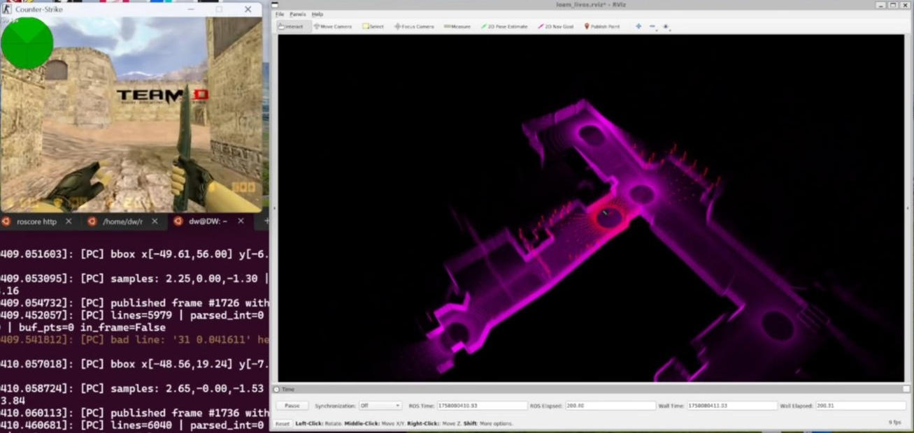

# CS1.6 → ROS：基于 GoldSrc 的虚拟 LiDAR / IMU 与 SLAM 建图

**让经典 FPS 游戏场景成为机器人 SLAM 的虚拟试验场。**

*演示视频约 2:13 处截图：左侧为 CS1.6 场景与桥接终端，右侧为 RViz 中的建图结果。点击图片观看视频。*

本项目在《Counter-Strike 1.6》的 GoldSrc 引擎中实现虚拟 LiDAR 与 IMU，通过 UDP 将游戏场景中的传感器数据实时传输至 ROS Noetic，并接入 FAST-LIO2 进行建图联调与可视化。

不同于传统的 Gazebo 仿真环境，这里直接利用游戏引擎已有的地图几何、碰撞检测和玩家运动状态，构建了一条从虚拟场景到机器人感知算法的完整数据通路。

[**▶ 观看建图演示（Bilibili）**](https://www.bilibili.com/video/BV1hYpWztEcS/) · [复现与技术说明](docs/technical-notes.md)

## 系统架构

**CS1.6 / GoldSrc → 虚拟传感器 → UDP → ROS Noetic → FAST-LIO2 → RViz**

系统分为两个主要部分：

**游戏侧：`cs16_sensors_udp.sma`**

基于 AMX Mod X 实现传感器模拟：

- **虚拟 LiDAR**：利用 `trace_line` 对场景碰撞几何进行射线扫描，生成多线激光点云，支持扫描线数、角分辨率与采样间隔配置；量程通过源码常量设置。
- **虚拟 IMU**：根据玩家姿态和运动状态生成四元数、角速度与线加速度，并进行滤波与限幅处理。
- **坐标转换**：处理 GoldSrc 世界坐标与机器人机体系之间的转换，将游戏单位统一换算为米。
- **数据传输**：通过 UDP 分帧发送点云与 IMU 数据，支持点云批量打包与帧边界标记。

**ROS 侧：`cs_udp_sensors_bridge.py`**

负责接收、解析与发布标准 ROS 消息：

- 将虚拟点云转换为 `sensor_msgs/PointCloud2`，发布至 `/velodyne_points`。
- 保留 `ring`、`time` 等字段，采用 XYZIRT 点云布局，便于适配 LiDAR 建图算法。
- 将模拟惯性数据转换为 `sensor_msgs/Imu`，发布至 `/cs/imu`。
- 支持帧组装、异常数据统计、距离过滤及可选的超时发布。

## 默认配置

| 参数 | 默认值 |
| --- | --- |
| LiDAR 扫描线数 | 32 |
| 水平角分辨率 | 2° |
| 扫描间隔 | 0.07 s |
| 最大量程 | 50 m |
| IMU 采样率配置 | 100 Hz |
| 点云 UDP 端口 | 9999 |
| IMU UDP 端口 | 10000 |
| ROS 发行版 | Noetic |

上述数值为插件默认配置，不代表独立测得的实际采样性能。

## 建图演示与工程价值

通过该系统，可以直接利用 CS1.6 地图生成虚拟点云与惯性数据，并在 ROS 中观察传感器输出及 FAST-LIO2 建图效果。

这个项目的重点并非重新实现 SLAM 算法，而是探索如何将非机器人仿真平台转换为可用的算法测试输入环境。

其中涉及的坐标系约定、传感器消息适配、点云时间字段、UDP 数据传输与调试流程，也属于机器人感知系统集成中的实际工程问题。

## 项目定位

本仓库提供游戏侧传感器插件与 ROS 桥接程序。FAST-LIO2 为外部建图组件，需要单独配置。

虚拟 IMU 和 LiDAR 采用简化的传感器模型，适用于数据通路调试、算法接入探索与建图效果演示，不作为高保真传感器仿真或精度评测基准。
